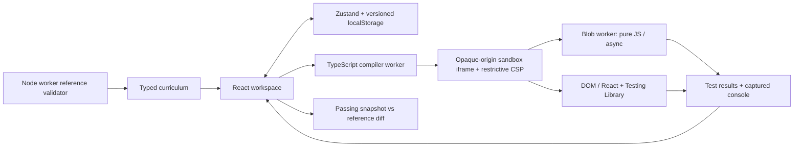

# Ship It

A project-first coding trainer focused on moving from junior foundations toward independent feature ownership and senior engineering judgment. Predict a failure, write code, verify behavior, explain a decision, then revisit from memory.

Open **Growth plan** for a suggested session, six engineering labs, your recall queue, and real-repository assignments. See [LEARNING_REVIEW.md](LEARNING_REVIEW.md) for the educational review and the limits of what this app measures.

## Run locally

Use Node.js 22.12+ (Node 24 is supported).

```sh
npm i
npm run dev
```

Open the URL Vite prints, normally `http://127.0.0.1:5173`. On Windows with a restricted PowerShell execution policy, use `npm.cmd` in place of `npm`.

```sh
npm test                  # store, reward logic, harness, and every reference
npm run validate-content  # execute all 25 reference solutions in isolated Node workers
npm run build             # content validation + strict TypeScript + production bundle
npm run preview           # serve the production build
npx playwright install chromium
npm run test:e2e           # real browser sandbox and full learning loop
```

`predev` and `build` generate the sandbox runtime bundles. They are intentionally not checked in. No API keys, database, external editor CDN, or backend are needed.

Browser tests start their own clean development server on port 5175, preserving your normal workspace on 5173 and avoiding stale hot-reloaded test fixtures. Set `SHIP_IT_TEST_PORT` if that port is occupied.

## What is included

- 59 curriculum tickets across six sprints, plus six engineering labs. **25 are fully playable:** eight JavaScript fundamentals tickets and their boss, six DOM/async tickets, four React tickets, and six reliability/testing labs.
- All later content is explicitly marked **Coming soon**. The app does not award progress for unfinished content.
- Strictly ordered unlocks, with a separately labeled React preview lab so you can use the React runner immediately.
- A locally bundled Monaco editor, real TypeScript diagnostics, multiple files, starter diffs, worker-based Prettier, and format-on-save. A working text editor appears immediately; Monaco loads on focus or hover and preserves in-flight edits and cursor position.
- Isolated JavaScript/TypeScript worker execution; real browser DOM and React/Testing Library execution in an opaque-origin iframe.
- Per-test XP without hint penalties, calendar-day streaks with one lifetime grace day, evidence-oriented badges, a sprint board, a skills heatmap, and post-pass code review. Speed and line-count rewards have been removed.
- A growth plan from foundations to feature ownership and broader engineering responsibility; concrete planning and review prompts for every playable ticket; saved explanations, test evidence, and trade-offs.
- Fresh-code recall scheduled after 1, 3, 7, then 21 days. Recall drafts remain separate from working code and passing snapshots. Only a due, unassisted passing session advances the schedule; early practice is always available.
- Four real-repository assignments for design, delivery, incident analysis, and mentoring, with saved evidence and Markdown export. Written evidence is explicitly self-reported, not automatically graded.
- Autosaved per-ticket drafts, passing snapshots, JSON backup/restore, confirmation before destructive resets, and source export.
- Dark and light themes, keyboard command palette, mobile workspace tabs, semantic controls, focus-trapped Radix dialogs, and reduced-motion support.

## Architecture



`src/types.ts` defines the shared domain model. `src/content/curriculum.ts` contains the six sprints and executable exercises. `src/store.ts` owns all persistent learning state. Components under `src/components` implement the workspace and progress views. `src/runner` contains the common assertion harness, compiler, isolated runtimes, and browser coordinator.

## Sandbox and test execution

1. A compiler Web Worker transpiles learner files and tests to CommonJS. It reports syntax errors and injects time guards into synchronous loops and function bodies. Learner source never executes on the host application thread.
2. The host creates an `iframe` with `sandbox="allow-scripts allow-forms"`, without same-origin, top-navigation, download, or popup permissions. Form events are enabled so React submit handlers work; CSP `form-action 'none'` blocks form navigation. The policy also denies external scripts, connections, images, and other resources. A nonce authorizes only the prebundled bootstrap; `unsafe-eval` permits compiled modules inside the isolated environment.
3. Pure-function tickets execute in a blob Web Worker created by that iframe. The worker inherits the iframe’s CSP, has no DOM, and has network and nested-worker APIs disabled. Browser DOM and React tickets execute in the iframe’s own document with locally bundled React 18 and Testing Library. API tickets use injected transports; no actual network call is made.
4. A source-checked message bridge returns individual results, expected/received values, learner-file stack locations, and capped console output. Execution has a 3-second deadline; compilation and runtime initialization have separate deadlines. Cancellation or navigation removes the frame and terminates its worker. Syntax and assertion failures remain inside the result panel.

This is a local learning sandbox, not a hostile-code judging service. Hidden tests and reference solutions are bundled client-side and can be inspected with developer tools. A learner can manipulate their own local progress. See `DECISIONS.md` for the iframe interruption boundary and other limits.

## Learning and rewards

- Each unique passing test earns its share of the ticket’s XP. Reruns cannot farm points. Passed test names are retained as milestones even if a later draft regresses.
- Hints are recorded but never reduce XP. Existing backups are recalculated under this policy. Asking for help is compatible with learning; later recall gives a separate opportunity to practice independently.
- Passing a complete suite records a separate passing snapshot and unlocks the next available ticket. A failed refactor does not erase completed progress.
- Reviews are accessible only after passing. The learner is invited to explain their approach, test evidence, and trade-off before explicitly opening the reference comparison. Notes are optional, saved, and never treated as a correctness assessment.
- Recall sessions hide previous explanations, hints, and the passing comparison while active. Ending the session restores the normal draft and review access. Recall cannot earn additional test XP or overwrite normal attempts. The app cannot detect outside help or certify retained understanding.
- The growth plan distinguishes tests passed, reasoning recorded, and later recall verified. These are learning signals, not a job-level score.
- Streaks use local calendar days and advance on a day with a passing test. One missed day can be bridged once. The freeze is not automatically refilled.
- Source export writes an archive-shaped JSON file containing passing ticket implementations. It is not advertised as a deployable Taskflow application: later full-stack curriculum is not yet authored.

## Keyboard and accessibility

`Ctrl/Cmd+Enter` runs tests. `Ctrl/Cmd+S` formats and saves. `Ctrl/Cmd+K` opens the ticket palette, with arrow-key navigation and Enter to select. Monaco supports its standard accessibility help and `Ctrl+M` to toggle Tab-key focus navigation. Dialogs trap and restore focus. Result updates use a live region. The celebration can be dismissed and is disabled under reduced motion.

## Authoring

See [content/README.md](content/README.md). Every authored reference must pass its own tests before a production build succeeds. Reference validation uses the same compilation and assertion harness as the browser, with jsdom for trusted DOM/React references. The browser suite separately verifies the real CSP-isolated runners.

## Verified results

See [VERIFICATION.md](VERIFICATION.md) for build and test results, audit scope, metrics, and screenshots.

## Reading the code

Anchors for the claims above, so they can be checked rather than trusted:

- **Curriculum shape.** `src/content/curriculum.ts:832-944` defines six sprints. Sprint 1 is eight tickets plus a boss; sprints 2-6 are nine tickets plus a boss each (59 entries). `future()` and `futureBoss()` (`curriculum.ts:790-831`) generate the 40 coming-soon entries with empty tests. The six labs are `ENG-001`-`ENG-006` in `src/content/engineering.ts`. `allTickets` and `seededTickets` (`curriculum.ts:945-949`) give 65 and 25.
- **Test names.** `seed()` extracts names with `/test\('([^']+)'/g` (`curriculum.ts:49`), so only single-quoted test names are recognized. A double-quoted test would run but be missing from `testNames`; `scripts/validate-content.ts:17-22` catches that as a count mismatch.
- **Four separate time limits.** Compilation 30 s (`src/runner/client.ts:38-44`), sandbox start-up 10 s (`client.ts:108-116`), execution 3 s from the frame's `ready` message (`client.ts:79-87`), and an in-sandbox guard that throws after 2.5 s inside instrumented loops and functions (`src/runner/harness.ts:111-116`).
- **Sandbox boundary.** `sandbox="allow-scripts allow-forms"` (`client.ts:67`) and the CSP in the `srcdoc` (`client.ts:107`). The host accepts a result only from that iframe's window and with the run's random id (`client.ts:75-93`).
- **Progress rules.** Storage key `ship-it.progress.v1` (`src/store.ts:12`); streak with one lifetime grace day (`store.ts:66-79`); recall intervals `[1, 3, 7, 21]` days (`src/learning.ts:10-17`); imported results are rejected if any name is not one of the ticket's `testNames` (`store.ts:337`).

## Exercises

1. **Goal:** see the sandbox refuse the network.
   **Check:** in any worker-runtime ticket, call `fetch('https://example.com')` inside a tested function and run; the test fails with "Network and nested workers are disabled in this sandbox. Use the injected API mock." (`src/runner/worker-runtime.ts:3-21` replaces `fetch`, `XMLHttpRequest`, `WebSocket`, `EventSource`, `importScripts`, `Worker` and `SharedWorker`), and the CSP's `connect-src 'none'` would block the request even without that override.
2. **Goal:** distinguish the 2.5 s guard from the 3 s deadline.
   **Check:** a `while (true) {}` loop fails with the harness message "Execution timed out. Check loops and recursive calls…", while `await new Promise(() => {})` fails with the host's "Execution timed out after 3 seconds…" message.
3. **Goal:** prove XP cannot be farmed.
   **Check:** pass a ticket, note the XP, rerun the same passing code twice; the total does not change (covered by `tests/store.test.ts`, "unlocks linearly and never farms XP from repeat runs").
4. **Goal:** add a ticket end to end.
   **Check:** following `content/README.md`, a new seeded ticket makes `npm run validate-content` print one more `PASS` line, and `tests/content.test.ts` must be updated from 25 to 26 before `npm test` passes again.

## Review notes

- The result bridge trusts whatever the frame posts with the run id (`client.ts:92-93`). In iframe mode, learner code shares the document with the bridge script, so it can in principle post its own result. This is consistent with the stated non-goal (progress is not tamper-resistant); the store's name check (`store.ts:337,504`) limits forgeries to known test names.
- `content/README.md` requires review notes to reference an existing file and a real line number, but neither `scripts/validate-content.ts` nor `tests/content.test.ts` checks `review[].file` or `review[].line`; only the 40-word limit and note count are enforced.
- `runtimeCache` (`client.ts:2-11`) keeps the sandbox bundle text for the page's lifetime, so a rebuilt runtime is only picked up after a reload.

## Primary references

The implementation follows [Vite’s worker bundling API](https://vite.dev/guide/features#web-workers), [Monaco’s language-service configuration](https://microsoft.github.io/monaco-editor/typedoc/interfaces/languages_features_typescript_register.LanguageServiceDefaults.html), and [React Testing Library’s render and cleanup API](https://testing-library.com/docs/react-testing-library/api/).
